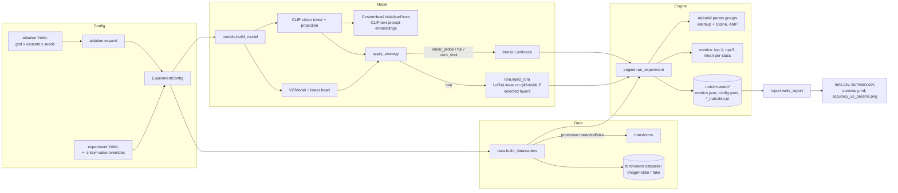

# VisTune

Parameter-efficient fine-tuning of **CLIP** and **ViT** vision backbones with **LoRA**, plus an
ablation harness that measures how adapter choices (rank, alpha, target modules, which blocks
get adapters, amount of data) affect **top-1 / top-5 accuracy** on domain-specific image
classification datasets.

- LoRA is implemented from scratch (`vistune/lora.py`): `LoRALinear` wraps a frozen
  `nn.Linear` and adds `(alpha / r) · B·A·x` with `B` zero-initialised, so training starts
  exactly at the pretrained model. Adapters can be merged into the base weights for inference.
- Backbones come from Hugging Face `transformers`: `ViTModel` (CLS token + linear head) and the
  CLIP vision tower + projection with a **zero-shot head built from text prompt embeddings**
  (prompt ensemble), so CLIP fine-tuning starts from its zero-shot accuracy.
- Strategies to compare: `zero_shot`, `linear_probe`, `lora`, `full`.
- Datasets: Flowers102, Oxford-IIIT Pets, DTD, FGVC Aircraft, EuroSAT (auto-download via
  torchvision), any `ImageFolder` directory, and a synthetic `fake` dataset for smoke tests.
  Few-shot subsampling (`data.shots_per_class`) and an optional validation split.
- Ablations: one YAML declares a grid × variants × seeds; runs are resumable and summarised into
  CSV / Markdown tables and an accuracy-vs-trainable-parameters plot.

## Architecture



### Layout

```
vistune/
  config.py    dataclass configs, YAML loading, dotted overrides
  data.py      dataset registry, transforms from the checkpoint's image processor, few-shot
  lora.py      LoRALinear, injection by name/layer, merge, freezing, adapter state dicts
  prompts.py   CLIP prompt-ensemble text embeddings
  models.py    ViT / CLIP classifiers, LoRA target presets, fine-tuning strategies
  metrics.py   top-k and per-class accuracy meter
  engine.py    train / eval loops, run_experiment, evaluate_checkpoint
  ablation.py  grid expansion and resumable ablation runner
  report.py    aggregation over seeds, Markdown/CSV tables, plot
  cli.py       `vistune train | evaluate | ablate | report`
configs/       base ViT / CLIP configs, smoke config, ablations/
tests/         unit tests (no downloads needed)
```

### LoRA target presets

| Preset | ViT (`transformers.ViTModel`) | CLIP vision tower |
|---|---|---|
| `qv` | `attention.query`, `attention.value` | `self_attn.q_proj`, `self_attn.v_proj` |
| `attn` | query, key, value, `attention.output.dense` | q/k/v/`out_proj` |
| `mlp` | `intermediate.dense`, block `output.dense` | `mlp.fc1`, `mlp.fc2` |
| `all` | all of the above | all of the above |

`lora.targets` also accepts an explicit list of module-name suffixes, and `lora.layers`
restricts adapters to specific blocks (negative indices count from the last block).

## How to run

Requirements: Python 3.10+. A CUDA GPU is strongly recommended for real datasets (ViT-B/16 with
LoRA fits comfortably in ~8 GB at batch size 64 with AMP). CPU and Apple MPS work for the
smoke configs. No API keys or credentials are needed; checkpoints download from the
Hugging Face Hub and datasets from torchvision on first use (into `data/`).

```bash
python -m venv .venv && source .venv/bin/activate
pip install -e ".[dev]"          # or: pip install -r requirements.txt
```

Single runs:

```bash
# CPU smoke test on synthetic data (downloads only the ViT checkpoint)
vistune train -c configs/smoke_fake.yaml

# LoRA on ViT-B/16 (IN-21k) for Flowers102
vistune train -c configs/base_vit.yaml

# CLIP: zero-shot baseline, then LoRA with rank 16 on all projections of the last 6 blocks
vistune train -c configs/base_clip.yaml -s train.strategy=zero_shot name=clip_pets_zs
vistune train -c configs/base_clip.yaml -s lora.rank=16 lora.targets=all "lora.layers=[-6,-5,-4,-3,-2,-1]"

# Your own data laid out as <root>/train/<class>/*.jpg and <root>/test/<class>/*.jpg
vistune train -c configs/base_vit.yaml -s data.name=imagefolder data.root=/path/to/dataset

# Re-evaluate a saved adapter + head checkpoint
vistune evaluate -c runs/vit_flowers_lora/config.yaml --checkpoint runs/vit_flowers_lora/best_trainable.pt
```

Each run writes `runs/<name>/` with `config.yaml`, `metrics.json` (per-epoch history, initial,
final and best test top-1/top-5, parameter counts) and `best_trainable.pt` /
`final_trainable.pt` containing only the trainable tensors (LoRA matrices + head), which is
typically well under 1% of the backbone size.

Set `data.val_fraction` (e.g. `0.1`) to pick the best epoch on a held-out validation split;
otherwise the "best" numbers are selected on the test set and are optimistic (the report
defaults to `final` accuracy for that reason).

Ablations:

```bash
vistune ablate configs/ablations/vit_rank_targets.yaml --list   # show the expanded runs
vistune ablate configs/ablations/vit_rank_targets.yaml          # run (resumes finished runs)
vistune report runs/ablations/vit_flowers_rank_targets          # rebuild tables + plot
```

Shipped ablations:

| File | Question |
|---|---|
| `vit_rank_targets.yaml` | Rank {1..32} × targets {qv, attn, mlp, all} vs linear probe and full fine-tuning on Flowers102 |
| `clip_alpha_layers.yaml` | LoRA alpha × which CLIP blocks are adapted (all / last 4 / first 4) vs zero-shot and linear probe on Pets |
| `clip_few_shot.yaml` | 1/4/16-shot EuroSAT: LoRA rank 4/16 vs linear probe |
| `smoke_fake.yaml` | Two tiny CPU runs to check the pipeline |

The report produces `summary.md` (mean ± std over seeds per configuration, sorted by top-1),
`summary.csv`, `runs.csv` and `accuracy_vs_params.png`.

## How to test

```bash
pip install -e ".[dev]"
pytest -q
```

The unit tests cover LoRA correctness (identity at initialisation, merge/unmerge equivalence,
injection by suffix and layer, parameter accounting), model wrappers on tiny randomly
initialised ViT and CLIP configs (no downloads), each LoRA preset and strategy, top-k metrics,
config overrides, ablation expansion/deduplication and report aggregation.

For an end-to-end check of the full pipeline, run the smoke ablation:

```bash
vistune ablate configs/ablations/smoke_fake.yaml
```
